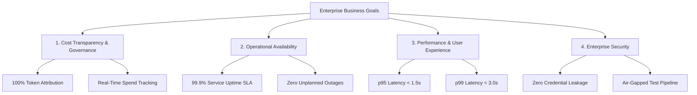
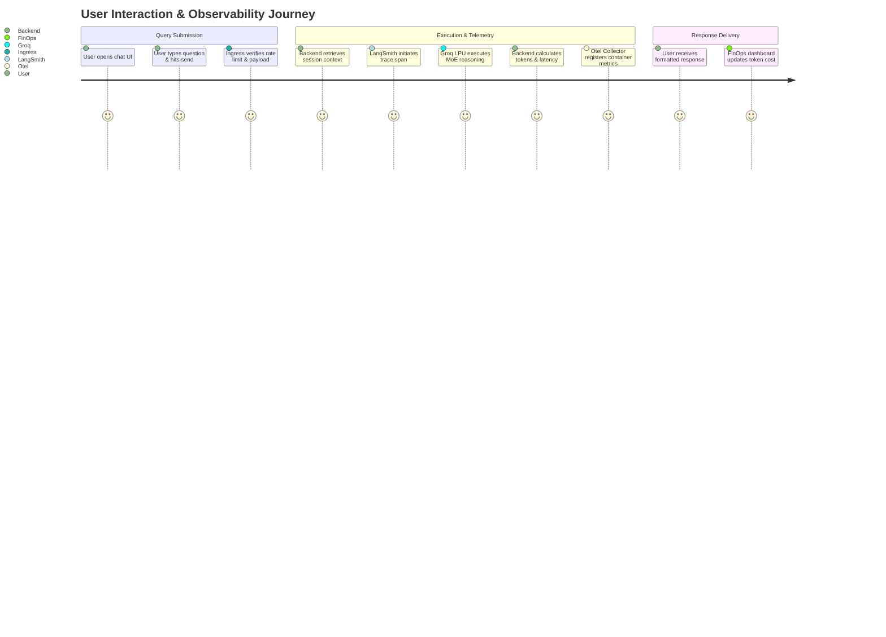

# 📋 Business Requirements Document (BRD)

**Project Name:** Observability & Cost Dashboard for an AI Service  
**Document Reference:** FDE-BRD-2026-v1.0  
**Status:** Approved  
**Author:** Forward Deployed Engineering (FDE) Team  

---

## 1. Executive Summary

As enterprise adoption of Generative AI accelerates, organizations face two existential operational hurdles: **opaque, runaway inference costs** and **the diagnostic "black box" of LLM execution chains**. 

This project delivers a production-grade, highly available conversational AI assistant backed by OpenAI's open-weights 120B Mixture-of-Experts (MoE) reasoning model (`openai/gpt-oss-120b`) deployed on **Groq LPUs**, combined with an enterprise-grade **Observability & Cost Management Dashboard**. 

By pairing ultra-fast inference with dual-plane observability (**OpenTelemetry, Prometheus, Grafana, CloudWatch, and LangSmith**), this solution bridges the gap between engineering velocity, operational reliability, and financial governance (FinOps).

---

## 2. Problem Statement & Business Opportunity

### 2.1 The Problem
1. **Unpredictable AI Spending:** Without real-time, per-session, and per-token cost attribution, organizations experience unexpected monthly cloud invoices driven by inefficient user prompts and verbose completions.
2. **Operational Blind Spots:** Traditional APM tools monitor container CPU and memory, but cannot observe token consumption, model reasoning steps, rate limits (HTTP 429), or upstream provider latency.
3. **User Friction:** Slow inference speeds (>5 seconds per response) lead to customer drop-off.
4. **Data Security & Secret Exposure:** Insecure client-side API integrations expose enterprise LLM keys to reverse engineering and credential scraping.

### 2.2 The Business Opportunity
* **Immediate FinOps Visibility:** Provide granular cost attribution per request, session, and project, enabling accurate departmental chargeback.
* **Sub-Second Customer Response:** Leverage Groq LPUs delivering ~500 tokens/second to achieve industry-leading user satisfaction.
* **Proactive SLA Governance:** Detect and mitigate infrastructure bottlenecks, rate-limiting surges, and upstream timeouts before they impact end-users.

---

## 3. Business Goals & Key Performance Indicators (KPIs)

### Quantifiable KPIs

| Objective | Target KPI | Measurement Mechanism | Business Impact |
| :--- | :--- | :--- | :--- |
| **Cost Attribution** | **100%** of LLM invocations captured with token metrics | LangSmith Usage Metadata & Prometheus Exporter | Prevents cost overruns; enables departmental chargeback. |
| **Service Availability**| **99.9% Uptime** (≤ 43.8 minutes downtime/month) | AWS Application Load Balancer & CloudWatch | Meets enterprise enterprise-grade SLA contracts. |
| **Inference Latency** | **p50 < 400ms, p95 < 1500ms, p99 < 3000ms** | Grafana Latency Percentiles & Ingress Logs | Maximizes customer engagement and reduces bounce rates. |
| **Error Rate** | **< 0.5%** 5xx Server Error Rate | CloudWatch Alarms & OpenTelemetry Spans | Protects brand reputation and reliability metrics. |
| **Test Automation** | **100% Mocked CI/CD**, 0 external API tokens burned | Pytest test suite (21 unit/integration tests) | Drastically reduces development and CI pipeline costs. |

---

## 4. Stakeholder Personas & Value Drivers

### 4.1 Chief Technology Officer (CTO) & VP of Engineering
* **Value Driver:** Deliver innovative Generative AI capabilities without introducing security vulnerabilities, infrastructure debt, or unbudgeted cloud expenditures.
* **Core Requirement:** Scalable architecture on AWS EKS with Infrastructure as Code (Terraform) and zero vendor lock-in.

### 4.2 FinOps Lead / Head of Cloud Economics
* **Value Driver:** Prevent bill shock by continuously monitoring token burn rates and translating raw tokens into dollar expenditures in real time.
* **Core Requirement:** Exportable dashboards displaying daily/monthly spend trends and automated alerts when token burn exceeds normal thresholds.

### 4.3 Site Reliability Engineer (SRE) & Platform Lead
* **Value Driver:** Ensure high availability, automated pod scaling, and rapid Mean Time to Detection (MTTD) and Resolution (MTTR).
* **Core Requirement:** Centralized Prometheus metrics, Grafana dashboards, automated CloudWatch alarms on P99 latency and 5xx spikes, and Horizontal Pod Autoscaling (HPA).

### 4.4 AI / Prompt Engineer
* **Value Driver:** Understand how the model interprets prompts, debug reasoning traces, and continuously optimize prompt structure for token efficiency.
* **Core Requirement:** Native integration with **LangSmith** for full-depth prompt evaluation, session debugging, and token inspection.

### 4.5 End User / Enterprise Client
* **Value Driver:** An intuitive, responsive, ChatGPT-quality conversational interface with multi-turn memory and instant code block formatting.
* **Core Requirement:** Zero latency lag, clean dark/light UI, and reliable responses.

---

## 5. Scope of Work

### 5.1 In-Scope (Phase 1 & Phase 2 Delivery)
* Production-ready conversational AI backend built on FastAPI, LangChain, and Groq LPUs (`openai/gpt-oss-120b`).
* Dual-plane observability: Infrastructure (Prometheus, Grafana, CloudWatch, OpenTelemetry) + Application (LangSmith).
* Multi-turn session continuity with server-side sliding-window context management.
* Zero-vulnerability Vanilla JS/CSS web interface with markdown parsing and copyable code blocks.
* Multi-container Docker Compose local development environment.
* Enterprise Kubernetes manifests (Deployment, HPA, NetworkPolicy, PDB, Ingress).
* AWS EKS Terraform Infrastructure as Code.
* Comprehensive 21-test automated testing suite with zero-token mocking.

### 5.2 Out-of-Scope (Future Roadmaps)
* Ingesting multi-gigabyte external PDF documents via Retrieval-Augmented Generation (RAG) (planned for Phase 3).
* User authentication via OAuth2/SAML/Okta (delegated to enterprise ingress/API gateway layer).
* Fine-tuning proprietary open-weights models.

---

## 6. End-to-End Business User Journey

---

## 7. Business Risk & Mitigation Matrix

| Identified Risk | Probability | Severity | Mitigation Strategy |
| :--- | :--- | :--- | :--- |
| **Groq API Rate Limits (429)** | Medium | High | Application-level exception mapper translates 429 into friendly user guidance; CloudWatch alarm notifies operators of quota limits. |
| **Token Cost Spikes** | Medium | High | Guardrails enforce `MAX_MESSAGE_LENGTH=4000` and sliding-window `MAX_HISTORY_TURNS=10`, bounding context size and token consumption. |
| **API Key Leakage** | Low | Critical | Strict separation of backend memory from frontend assets; keys are excluded from git via root and child `.gitignore` rules. |
| **Provider Downtime (502/504)**| Low | High | Health and readiness probes isolate failing pods; standardized fallback errors prevent application hangs. |
| **Data Privacy & PII Leakage** | Medium | Medium | LangSmith tracing is strictly opt-in (`LANGSMITH_TRACING=false` by default). Test suite operates 100% offline without sending data to external endpoints. |

---

## 8. Compliance, Governance & Data Sovereignty

1. **Non-Custodial Testing:** Automated CI/CD runs never communicate with external AI servers, eliminating the risk of test data being ingested by third-party model providers.
2. **Credential Hygiene:** API keys are injected at runtime via environment variables or Kubernetes Secrets and are never stored in source control.
3. **Data Retention Controls:** For enterprise deployments utilizing LangSmith, retention policies should be set to 14 or 30 days in accordance with corporate data retention mandates.
  