# 📁 Forward Deployed Engineering (FDE) Documentation Suite

Welcome to the **Forward Deployed Engineering (FDE) Documentation Suite** for the **Observability & Cost Dashboard for an AI Service**. 

This suite provides the enterprise governance, architectural blueprints, and engineering contracts governing the design, deployment, scaling, and observability of the production Q&A Chatbot platform.

---

## 📑 Document Navigator

```
FDE-docs/
├── README.md   # Suite Overview, Document Governance & Stakeholder Matrix
├── BRD.md      # Business Requirements Document (Business Value, ROI, SLAs, FinOps)
├── TRD.md      # Technical Requirements Document (Infrastructure, Topology, Sizing, Telemetry)
└── SRD.md      # Software Requirements Document (API Contracts, Functional/NFRs, State, BDD)
```

| Document | Primary Focus | Key Stakeholders |
| :--- | :--- | :--- |
| **[BRD.md](file:///d:/Observability%20and%20cost%20dashboard%20for%20an%20AI%20service/FDE-docs/BRD.md)** | **Business Requirements Document**<br/>Business rationale, FinOps cost control, token economics, customer user journeys, uptime SLAs, and compliance guardrails. | VP of Engineering, Chief AI Officer, FinOps Team, Product Managers |
| **[TRD.md](file:///d:/Observability%20and%20cost%20dashboard%20for%20an%20AI%20service/FDE-docs/TRD.md)** | **Technical Requirements Document**<br/>AWS EKS infrastructure sizing, VPC network topology, OpenTelemetry Collector pipelines, Grafana/CloudWatch telemetry, and security hardening. | Lead Cloud Architect, SREs, DevOps Engineers, Security Officers |
| **[SRD.md](file:///d:/Observability%20and%20cost%20dashboard%20for%20an%20AI%20service/FDE-docs/SRD.md)** | **Software Requirements Document**<br/>Functional and non-functional specifications, state machine, API data contracts, error taxonomies, and BDD acceptance criteria. | Backend Engineers, QA Leads, Frontend Engineers, API Integrators |

---

## 🏛️ System Value Proposition

```mermaid
graph LR
    subgraph BusinessValue ["Business Value (BRD)"]
        B1["100% Token Cost Visibility"]
        B2["99.9% Service SLA"]
        B3["Ultra-Low Latency Inference"]
    end

    subgraph TechnicalExcellence ["Technical Architecture (TRD)"]
        T1["AWS EKS & Terraform IaC"]
        T2["OpenTelemetry Collector & Prometheus"]
        T3["Multi-AZ High Availability"]
    end

    subgraph SoftwareEngineering ["Software Engineering (SRD)"]
        S1["FastAPI Modular Backend"]
        S2["LangChain Groq LPU Engine"]
        S3["LangSmith Tracing Seams"]
    end

    BusinessValue <--> TechnicalExcellence
    TechnicalExcellence <--> SoftwareEngineering
```



---

## 👥 Stakeholder Sign-Off Matrix

| Role | Name / Title | Responsibility | Sign-Off Status |
| :--- | :--- | :--- | :--- |
| **FDE Lead** | Abhishek Kumar | Architecture, Integration, Observability | Approved |
| **Engineering Lead** | Platform Engineering Lead | Infrastructure, EKS Cluster, CI/CD | Approved |
| **FinOps Sponsor** | Head of Cloud Economics | Token Budgeting & Cost Allocation | Approved |
| **Security & Privacy** | CISO Representative | Zero-Trust Policies, Secret Hardening | Approved |
