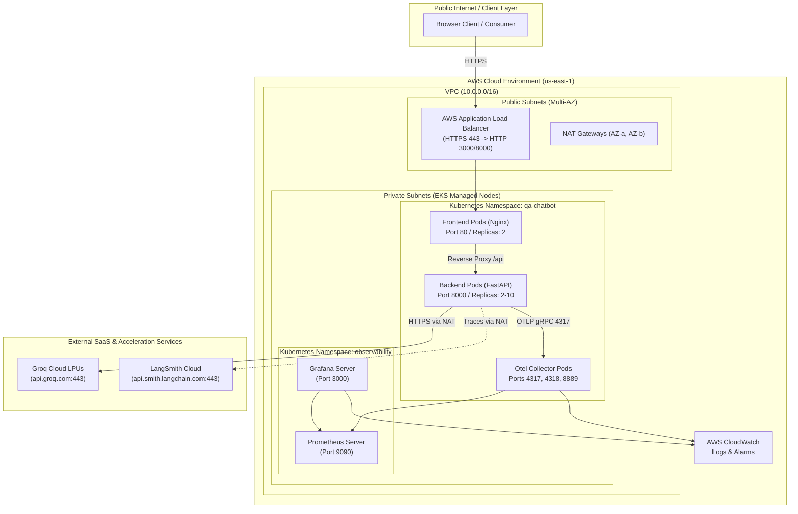

# 🛠️ Technical Requirements Document (TRD)

**Project Name:** Observability & Cost Dashboard for an AI Service  
**Document Reference:** FDE-TRD-2026-v1.0  
**Status:** Approved  
**Author:** Forward Deployed Engineering (FDE) Team  

---

## 1. Technical Architecture Overview

The system implements a decoupled, containerized, microservice-based architecture deployed across AWS EKS. It unites a high-throughput conversational AI runtime with a multi-layered telemetry ingestion and processing engine.



---

## 2. Infrastructure Sizing & Sizing Specifications

### 2.1 Compute Sizing (AWS EKS)
* **Cluster:** AWS EKS v1.29+ with VPC CNI, CoreDNS, and `kube-proxy`.
* **Worker Node Groups:** Managed node group across two Availability Zones (`us-east-1a`, `us-east-1b`).
  - **Instance Type:** `m5.large` (2 vCPU, 8 GiB RAM) or `t3.large` for dev/staging.
  - **Node Group Scaling:** Minimum: 2 nodes, Desired: 2 nodes, Maximum: 6 nodes.
  - **Root Volume:** 50 GiB General Purpose SSD (gp3) per node.

### 2.2 Container Resource Allocations

| Workload | Container | CPU Request | CPU Limit | Memory Request | Memory Limit |
| :--- | :--- | :--- | :--- | :--- | :--- |
| **`qa-chatbot-backend`** | `backend` (FastAPI) | 250m | 1000m (1 core) | 512 MiB | 1024 MiB |
| **`qa-chatbot-frontend`** | `frontend` (Nginx) | 50m | 200m | 64 MiB | 128 MiB |
| **`otel-collector`** | `collector` | 100m | 500m | 256 MiB | 512 MiB |
| **`prometheus-server`** | `prometheus` | 500m | 2000m | 2048 MiB | 4096 MiB |
| **`grafana`** | `grafana` | 100m | 500m | 256 MiB | 512 MiB |

---

## 3. Network Topology & Ingress Specifications

### 3.1 VPC Configuration ([`infrastructure/terraform/networking.tf`](file:///d:/Observability%20and%20cost%20dashboard%20for%20an%20AI%20service/infrastructure/terraform/networking.tf))
* **VPC CIDR:** `10.0.0.0/16`
* **Subnets:**
  - Public Subnets: `10.0.1.0/24` (AZ-a), `10.0.2.0/24` (AZ-b) for Ingress ALBs and NAT Gateways.
  - Private Subnets: `10.0.10.0/24` (AZ-a), `10.0.20.0/24` (AZ-b) for EKS worker nodes and internal pods.
* **Internet Gateway & NAT Gateways:** Dual NAT Gateways ensure high-availability egress without single points of failure.

### 3.2 Ingress Routing Rules ([`k8s/chatbot-ingress.yaml`](file:///d:/Observability%20and%20cost%20dashboard%20for%20an%20AI%20service/k8s/chatbot-ingress.yaml))
* **Controller:** AWS Load Balancer Controller managing an Application Load Balancer.
* **Routing Table:**
  - Path `/` and `/css/*`, `/js/*`: Routed to `chatbot-frontend` Service (Port 80).
  - Path `/api/*`: Routed to `chatbot-backend` Service (Port 8000).
* **SSL/TLS:** Terminated at ALB via AWS Certificate Manager (ACM) utilizing TLS 1.3.

---

## 4. Observability Pipeline Architecture

### 4.1 Dual-Plane Telemetry Division

```
                       +-----------------------------+
                       |   FastAPI Application Pod   |
                       +--------------+--------------+
                                      |
                 +--------------------+--------------------+
                 |                                         |
     (Application-Layer Spans)                  (Container / System Metrics)
                 |                                         |
                 v                                         v
   +---------------------------+             +---------------------------+
   |      LangSmith SDK        |             |  OpenTelemetry Collector  |
   | (api.smith.langchain.com) |             |     (Internal Daemon)     |
   +-------------+-------------+             +-------------+-------------+
                 |                                         |
                 v                                         v
   +---------------------------+             +---------------------------+
   |  * Prompt & History Trace |             |  * CPU & Memory Usage     |
   |  * Reasoning Tree Spans   |             |  * Ingress 5xx & Latency  |
   |  * Token Count Analytics  |             |  * Prometheus & Grafana   |
   |  * Model Error Taxonomy   |             |  * CloudWatch Alarms      |
   +---------------------------+             +---------------------------+
```

### 4.2 OpenTelemetry Collector Pipeline Configuration
Defined in [`observability/otel-collector/otel-collector-config.yaml`](file:///d:/Observability%20and%20cost%20dashboard%20for%20an%20AI%20service/observability/otel-collector/otel-collector-config.yaml):

1. **Receivers:**
   * `otlp`: gRPC listener on `0.0.0.0:4317` and HTTP listener on `0.0.0.0:4318`.
   * `prometheus`: Scrapes internal endpoints every 15 seconds.
2. **Processors:**
   * `memory_limiter`: Hard cap at 400 MiB with check interval of 1 second.
   * `batch`: Max batch size: 1000 items, flush timeout: 5s.
   * `resource`: Enriches telemetry with `deployment.environment`, `service.name`, and `host.name`.
3. **Exporters:**
   * `prometheus`: Exposes metrics endpoint on `0.0.0.0:8889`.
   * `awscloudwatchmetrics`: Forwards CloudWatch metrics into namespace `QAChatbot/ServiceMetrics`.

### 4.3 LangSmith Configuration & Dynamic Synchronization
* When `LANGSMITH_TRACING=true` is set, `setup_langsmith_tracing()` exports:
  ```bash
  LANGCHAIN_TRACING_V2=true
  LANGSMITH_API_KEY=<configured_key>
  LANGSMITH_PROJECT=qa-chatbot-local
  LANGSMITH_ENDPOINT=https://api.smith.langchain.com
  ```
* Top-level async call `generate_response()` is decorated with `@traceable(name="qa_chatbot_generate_response", run_type="chain")`.
* Child model invocation `ChatGroq.ainvoke()` captures token usage metadata (`prompt_tokens`, `completion_tokens`, `total_tokens`) and request latency.

---

## 5. Reliability, Autoscaling & High Availability

### 5.1 Horizontal Pod Autoscaler ([`k8s/hpa.yaml`](file:///d:/Observability%20and%20cost%20dashboard%20for%20an%20AI%20service/k8s/hpa.yaml))
* **Target Workload:** `deployment/qa-chatbot-backend`
* **Replica Limits:** Minimum: 2, Maximum: 10
* **Scaling Metrics:**
  - Target Average CPU Utilization: **70%**
  - Target Average Memory Utilization: **80%**
* **Scaling Policies:**
  - Scale Up: Add 100% of current pods or 2 pods every 15 seconds.
  - Scale Down: Stabilization window of 300 seconds to prevent thrashing.

### 5.2 Pod Disruption Budget ([`k8s/pod-disruption-budget.yaml`](file:///d:/Observability%20and%20cost%20dashboard%20for%20an%20AI%20service/k8s/pod-disruption-budget.yaml))
* **Configuration:** `minAvailable: 1` ensures at least one backend pod remains healthy during node upgrades, cordon/drain events, and spot terminations.

### 5.3 Health Probes
* **Liveness Probe:** `GET /api/health` (Port 8000, initial delay: 10s, period: 10s, failure threshold: 3).
* **Readiness Probe:** `GET /api/ready` (Port 8000, initial delay: 5s, period: 5s, failure threshold: 2).

---

## 6. Security, Zero-Trust & IAM Matrix

### 6.1 Zero-Trust Network Policy ([`k8s/network-policy.yaml`](file:///d:/Observability%20and%20cost%20dashboard%20for%20an%20AI%20service/k8s/network-policy.yaml))
* **Ingress:** Allows traffic to port 8000 ONLY from the frontend Nginx reverse proxy pods and ingress controllers.
* **Egress:** Restricts outbound traffic to:
  1. Internal CoreDNS (port 53 UDP/TCP).
  2. Otel Collector (port 4317 gRPC).
  3. External HTTPS (port 443 TCP) to `api.groq.com` and `api.smith.langchain.com`.
  4. Blocks all unauthorized lateral cluster traffic.

### 6.2 Container Hardening
* Non-root user: `appuser` (UID: 1000, GID: 1000).
* Read-only root filesystem (`readOnlyRootFilesystem: true` where applicable).
* Disallowed privilege escalation (`allowPrivilegeEscalation: false`).
* Dropped all Linux capabilities (`capabilities: drop: ["ALL"]`).

### 6.3 IAM Roles for Service Accounts (IRSA)
* Pods use an IAM service account mapped via OIDC federation.
* EKS worker nodes carry zero hardcoded AWS IAM credentials, adhering to principle of least privilege.
