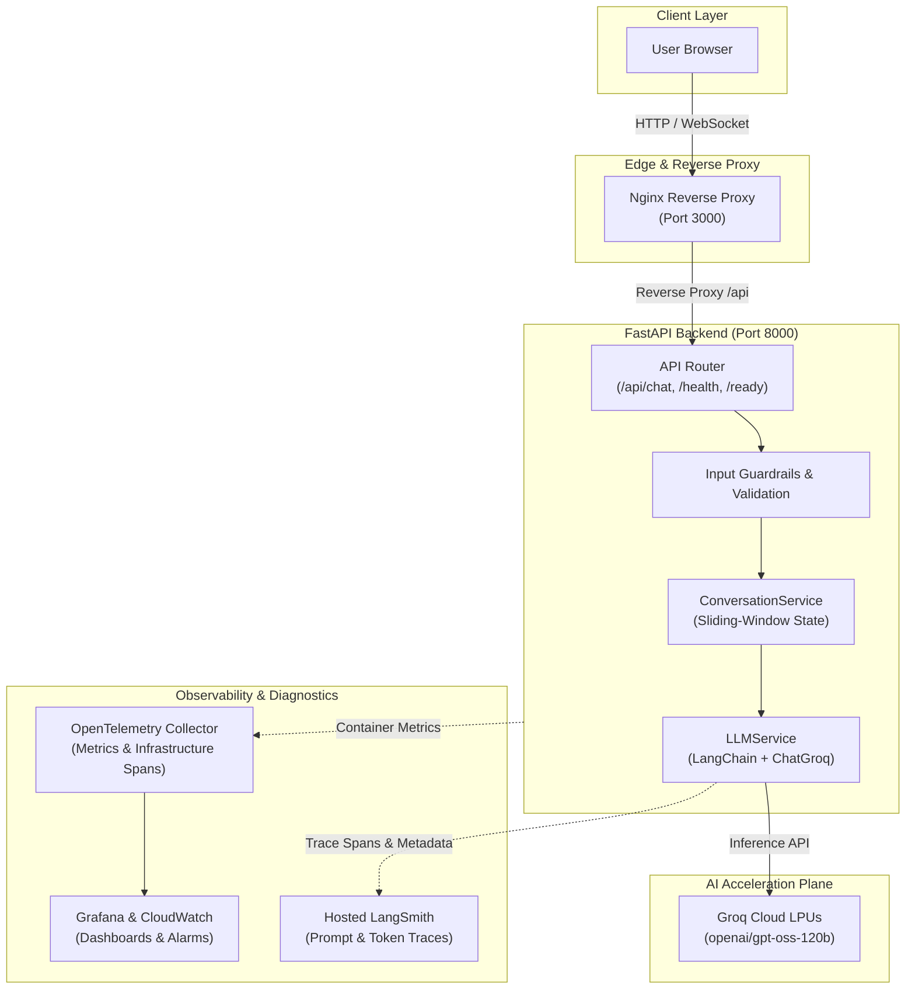

# 📚 Q&A Chatbot Documentation

Welcome to the comprehensive documentation for the **Q&A Chatbot** application and its integration with the Observability & Cost Dashboard.

---

## 📑 Documentation Index

| Document | Description | Target Audience |
| :--- | :--- | :--- |
| **[System Architecture](file:///d:/Observability%20and%20cost%20dashboard%20for%20an%20AI%20service/docs/architecture.md)** | End-to-end component design, data flow diagrams, multi-turn state management, security boundaries, and telemetry architecture. | Architects, Tech Leads, Senior Engineers |
| **[API Reference](file:///d:/Observability%20and%20cost%20dashboard%20for%20an%20AI%20service/docs/api-reference.md)** | Comprehensive REST API specification, schemas, error codes, HTTP status mappings, and cURL / Python examples. | Backend & Frontend Developers, API Consumers |
| **[Observability & Tracing](file:///d:/Observability%20and%20cost%20dashboard%20for%20an%20AI%20service/docs/observability-and-tracing.md)** | Deep dive into LangSmith tracing, OpenTelemetry Collector integration, Prometheus metrics, Grafana dashboards, and CloudWatch alarms. | SREs, DevOps, Platform Engineers |
| **[Setup & Deployment Guide](file:///d:/Observability%20and%20cost%20dashboard%20for%20an%20AI%20service/docs/setup-and-deployment.md)** | Step-by-step instructions for local development (native & Docker Compose) and production Kubernetes (EKS) deployment. | Developers, DevOps Engineers |
| **[Testing & Quality Assurance](file:///d:/Observability%20and%20cost%20dashboard%20for%20an%20AI%20service/docs/testing-guide.md)** | Automated test suite guide (21 unit/integration tests), zero-cost mocking strategy, and local diagnostic CLI scripts. | QA Engineers, Developers |

---

## ⚡ Quick Architecture Overview

---

## 🔍 Core Technologies

* **Backend Engine:** FastAPI 0.111+, Uvicorn ASGI Server, Pydantic v2.
* **LLM Orchestration:** LangChain 0.2+, `langchain-groq`, `langsmith`.
* **Inference Hardware:** Groq LPUs running OpenAI's open-weights 120B MoE Reasoning Model (`openai/gpt-oss-120b`).
* **Frontend:** Vanilla JavaScript (ES6+), semantic HTML5, pure CSS3 (Dark/Light glassmorphism theme, zero npm build step, XSS-immune DOM manipulation).
* **Observability:** LangSmith (application diagnostic plane), OpenTelemetry Collector (infrastructure/container metrics), Prometheus, Grafana, AWS CloudWatch.
* **Testing:** Pytest, `pytest-asyncio`, `httpx` (100% mocked, zero external API token burn during test runs).
