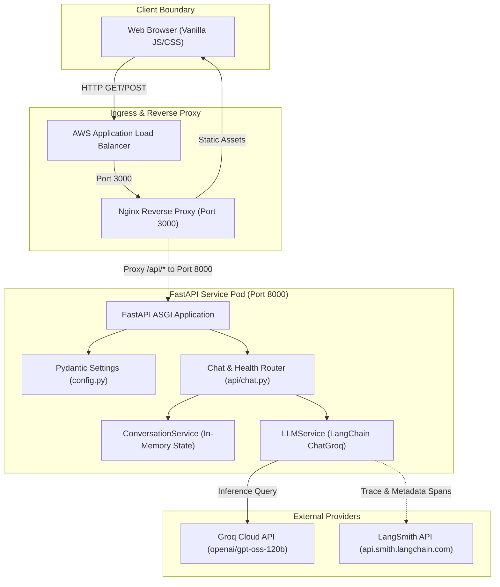
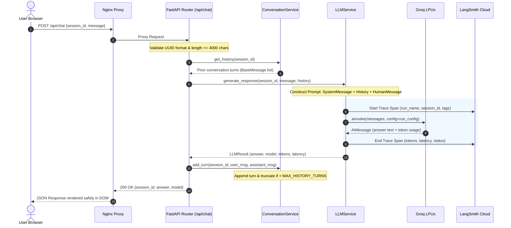

# 🏛️ System Architecture

This document describes the high-level system architecture, component boundaries, state management strategies, and security design of the **Q&A Chatbot** service.

---

## 1. Architectural Principles

The application is built upon five foundational principles:

1. **Separation of Concerns:** Distinct separation between API routing, dialogue state management, model orchestration, and telemetry emission.
2. **Deterministic Security:** Zero client-side credential exposure, strict input sanitization, least-privilege container execution, and XSS immunity.
3. **Low-Latency Inference:** Leveraging Groq's Language Processing Units (LPUs) to deliver near-instantaneous (~500 tokens/sec) reasoning responses.
4. **Resilient Error Mapping:** Translation of upstream provider failures (rate limits, timeouts, authentication errors) into standardized RFC-compliant HTTP status codes.
5. **Dual-Plane Observability:** 
   - **Infrastructure Plane:** OpenTelemetry Collector, Prometheus, and Grafana for pod metrics, CPU/memory saturation, and HTTP availability.
   - **Application Diagnostic Plane:** LangSmith for prompt inspection, reasoning tokens, execution chains, and evaluation datasets.

---

## 2. Component Architecture



---

## 3. Request Lifecycle & Sequence Diagram

The following sequence diagram illustrates the lifecycle of a user prompt submitted via the web client:



---

## 4. Subsystem Details

### 4.1 Backend Engine (`qa-chatbot/backend`)

The backend is developed with **FastAPI** and **Pydantic v2**:

* **Lifespan Management (`app.main:lifespan`):** Validates essential configuration on startup (`validate_startup_config`), initializes LangSmith environment variables (`setup_langsmith_tracing`), and logs masked credentials.
* **Unified Error Mapping:** A centralized exception handling layer intercepts all unhandled exceptions and known domain errors, translating them into standardized JSON error responses:
  ```json
  {
    "error": "RATE_LIMIT_EXCEEDED",
    "detail": "AI provider rate limit reached. Please wait a moment and try again.",
    "code": "HTTP_429"
  }
  ```
* **CORS Policy:** Flexible CORS middleware configured for cross-origin local testing or same-origin production reverse-proxying.

### 4.2 Conversation State Management (`ConversationService`)

* **Session Isolation:** Dialogue turns are grouped by a client-supplied UUID v4 (`session_id`). Separate sessions have zero cross-talk or data leakage.
* **Concurrency Protection:** Uses an `asyncio.Lock` per session operation to ensure safe updates under concurrent requests.
* **Sliding-Window Memory:** Keeps the most recent `MAX_HISTORY_TURNS` (default: 10 turns = 20 messages). Older turns are automatically pruned from the front of the deque, preserving the system prompt and recent context without exceeding token boundaries.
* **Stateless Client Guarantee:** While the frontend may transmit conversation history, the backend's server-side in-memory state is authoritative, preventing client-side prompt manipulation.

### 4.3 LLM Orchestration (`LLMService`)

* **Model:** OpenAI's Flagship Reasoning Model (`openai/gpt-oss-120b`) served via **Groq Cloud**.
* **Reasoning Effort:** Configurable reasoning depth (`none`, `low`, `medium`, `high`) allows dialing the MoE reasoning steps to trade latency vs analytical rigor.
* **Lazy Client Initialization:** The `ChatGroq` client is instantiated on demand, preventing startup failure if keys are temporarily unset during container initialization.
* **Telemetry Seams:** Extracts prompt tokens, completion tokens, total tokens, and precise execution latency on every invocation.

---

## 5. Security & Isolation Architecture

| Layer | Security Control | Implementation |
| :--- | :--- | :--- |
| **Container** | Least-Privilege Execution | Runs under non-privileged user `appuser` (UID: 1000). Root access is dropped after package installation. |
| **Filesystem** | Immutable Image | Python bytecode compilation disabled (`PYTHONDONTWRITEBYTECODE=1`), container runs stateless without persistent disk writes. |
| **Network** | Zero-Trust Egress | Kubernetes `NetworkPolicy` restricts egress to DNS (port 53) and HTTPS (port 443 to `api.groq.com` and `api.smith.langchain.com`). |
| **Credentials** | Key Isolation | `GROQ_API_KEY` and `LANGSMITH_API_KEY` are stored strictly in server memory. Keys are never logged in full, never returned in API payloads, and never bundled in frontend assets. |
| **Frontend** | XSS Immunity | Response rendering uses DOM methods (`document.createTextNode`, `textContent`). Raw HTML injection via `innerHTML` is strictly prohibited. |
| **API Guardrails** | Payload Enforcements | Requests enforce maximum character length (`MAX_MESSAGE_LENGTH=4000`), UUID validation, and strict Pydantic type checking. |

---

## 6. Observability Dual-Plane Architecture

```
+---------------------------------------------------------------------------------+
|                              EKS Worker Node / Pod                              |
|                                                                                 |
|   +------------------------------------+   +--------------------------------+   |
|   |         Infrastructure Layer       |   |       Application / LLM Layer  |   |
|   |  (CPU, Memory, Network, Restarts)  |   | (Prompts, Token Counts, Chains)|   |
|   +-----------------+------------------+   +---------------+----------------+   |
+---------------------|--------------------------------------|--------------------+
                      |                                      |
                      v                                      v
       +------------------------------+       +------------------------------+
       |   OpenTelemetry Collector    |       |       Hosted LangSmith       |
       |  (Internal Cluster Daemon)   |       |   (api.smith.langchain.com)  |
       +--------------+---------------+       +------------------------------+
                      |                                      |
                      v                                      v
       +------------------------------+       +------------------------------+
       |   Prometheus & CloudWatch    |       |    Traces, Runs & Datasets   |
       +--------------+---------------+       +------------------------------+
                      |
                      v
       +------------------------------+
       |      Grafana Dashboards      |
       +------------------------------+
```
